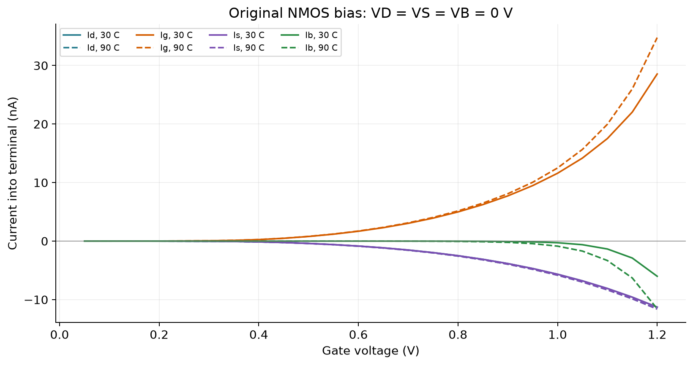
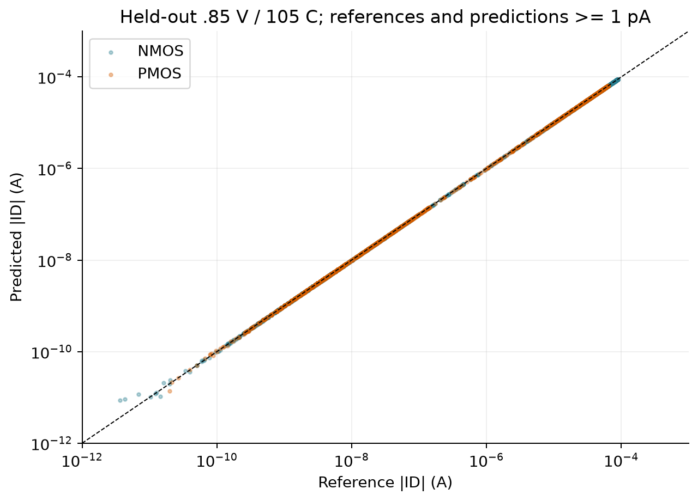
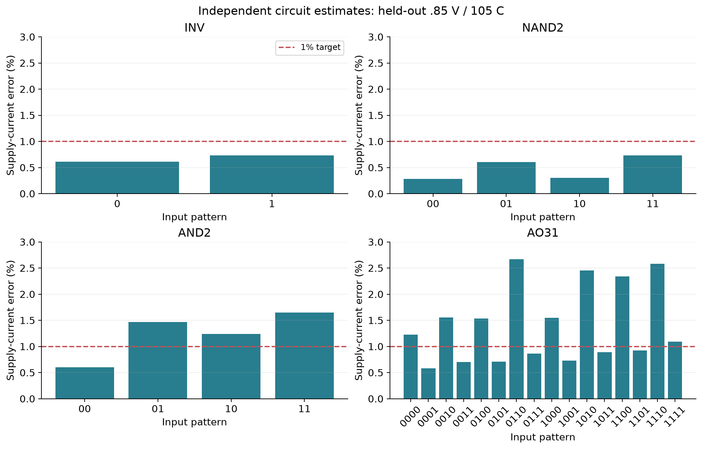
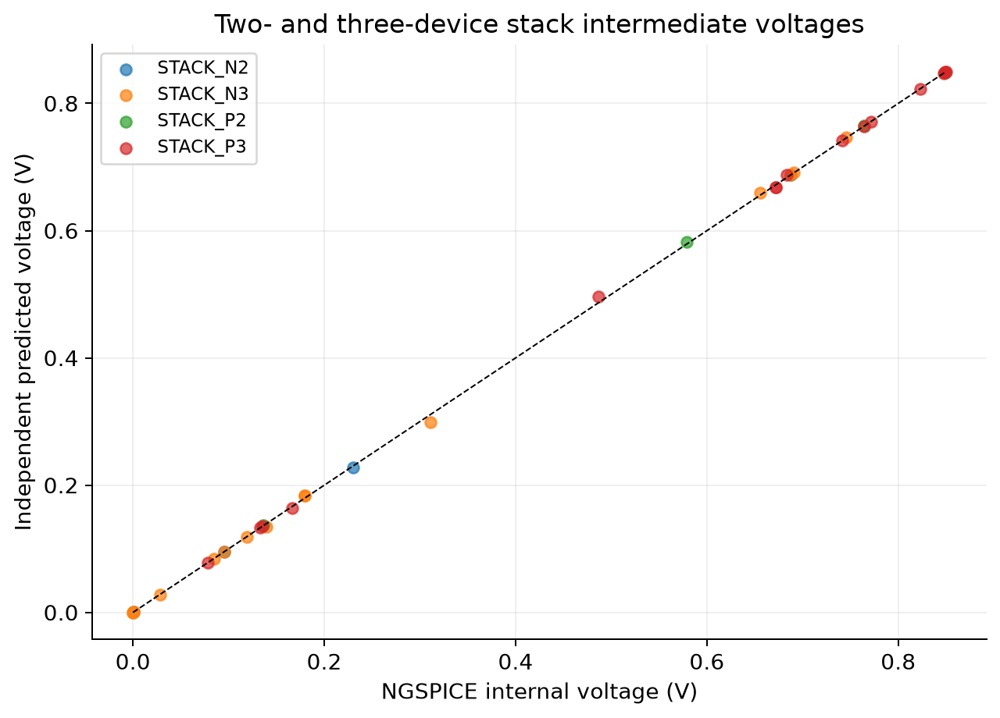

# Executed leakage-estimation results

**Workflow implemented and checked; the universal <1% target is not achieved.**
All 16 PDF pages were visually inspected. Page4 explicitly targets R2>0.99 and
error<1% against simulation, but does not define the error statistic or scope.
See [requirements review](docs/requirements_review.md) and [reproduction/viva guide](README.md).

## Single-device milestone: passed physical consistency checks

The supplied 22nm NMOS has VD=VS=VB=0V. The original loop actually generated
48 rows: VG=.05..1.20V, at 30/90C. It skips zero bias. VDS=0 means
this is not a conventional on-current sweep, despite the filename.

* Maximum signed gate current magnitude: 3.47683962e-08 A.
* Maximum gate current with tunnelling disabled: 4.44089e-16 A (numerical residue).
* Path-only copy maximum terminal KCL residue: 1.13505e-15 A.
* Verified-copy maximum KCL residue: 9.20195e-16 A;
  maximum normalized imbalance 0.00110342%.
* TOXE/TOXP/DTOX warning is preserved. NGSPICE43 dispatches card version4.0 to BSIM4v5.
* Device current is -I(terminal voltage source); all four signed currents balance.

## Dataset and evaluation scope

16,236 rows implement the four PDF configurations over voltage, temperature,
W/L. Another 52,480 rows span independent drain/source bias at the fixed circuit
geometry. Every row retains type, model hash, SI-labelled measurements, bias
configuration, temperature and netlist provenance. Generated netlists, logs and
text exports are retained. Source PDF/netlist/model files match initial hashes;
all ten model files also match their archived originals.

General-device training is .7/.8/.9V and -40/0/30/60/90/125C. Validation is
.75V/45C; final test is .85V/105C. Complete operating conditions stay together.
Four-case validation/test temperatures are 45/105C. Models were selected by
validation criteria or specified before test inspection, without test tuning.
These are limited held-out conditions, not evidence of accuracy everywhere.

## Held-out isolated-device metrics

Raw-current R2, MAE and RMSE use amperes. Relative error is
100*|prediction-reference|/max(|reference|,1pA). Below 1pA it is a scaled
absolute error, not ordinary relative error. CSVs also contain MAPE above 1pA,
the near-zero fraction and fraction within1%. Signs are retained in scoring.

| task | terminal | R2 | MAE_A | RMSE_A | floored_mean_relative_pct | floored_p95_relative_pct | floored_max_relative_pct |
| --- | --- | --- | --- | --- | --- | --- | --- |
| general_nmos | Id_A | 0.999975 | 9.28386e-08 | 1.6013e-07 | 1.23793 | 2.02575 | 133.257 |
| general_nmos | Ig_A | 0.999983 | 2.10843e-11 | 3.09766e-11 | 0.491588 | 1.63683 | 8.90373 |
| general_nmos | Is_A | 0.999975 | 9.28357e-08 | 1.60121e-07 | 1.13339 | 2.0081 | 151.817 |
| general_nmos | Ib_A | 0.999584 | 2.84152e-12 | 6.33636e-12 | 1.33733 | 3.76656 | 4.19826 |
| general_pmos | Id_A | 0.999992 | 4.00127e-08 | 6.79865e-08 | 0.722016 | 1.62169 | 30.1042 |
| general_pmos | Ig_A | 0.999842 | 9.90461e-11 | 2.0521e-10 | 0.585647 | 1.76234 | 5.23839 |
| general_pmos | Is_A | 0.999992 | 3.99532e-08 | 6.79099e-08 | 1.03309 | 1.59795 | 377.718 |
| general_pmos | Ib_A | 0.999562 | 1.79409e-11 | 4.02412e-11 | 1.42192 | 1.94696 | 2.04433 |

All general-device terminal R2 values exceed .99; mean/p95/max relative-error
targets do not uniformly pass. In particular, large relative errors can occur
at terminal-current cancellation points even while global R2 is excellent.
Polynomial baseline comparisons are in [all device metrics](generated/evaluation/device_metrics.csv).

Four-case selected local-quadratic **drain-current** results:

| task | R2 | MAE_A | RMSE_A | floored_mean_relative_pct | floored_p95_relative_pct | floored_max_relative_pct |
| --- | --- | --- | --- | --- | --- | --- |
| NMOS_cond | 0.999986 | 4.1838e-11 | 6.28612e-11 | 22.9068 | 135.008 | 400.04 |
| NMOS_int | 0.998867 | 8.33825e-10 | 2.13333e-09 | 81.1485 | 89.5973 | 4369.93 |
| PMOS_cond | 0.999988 | 3.8034e-11 | 5.17403e-11 | 21.0401 | 107.937 | 361.243 |
| PMOS_int | 0.999336 | 2.70536e-09 | 5.57089e-09 | 81.8687 | 89.7975 | 4496.57 |

These local fits improve the polynomial baseline but fail relative-error
requirements. Bias sign changes and weak-current behavior remain poorly fit.
Literal PMOS_int also forward-biases its source/well junction: at |Vref|=1V,
30C, W44/L22nm, source current is about1.18mA. It is not pure cutoff leakage.

## Complete gates and intermediate voltages

250 cases cover INV, NAND2, AND2, AO31, and NMOS/PMOS two/three-device chains,
every input combination, at five operating conditions. All direct logic truth
tables pass. All independent KCL solves converge to <1fA nodal imbalance.
Stack all-on patterns conduct ordinary DC current; they are not leakage-only.

The estimator receives only known topology, inputs, VDD,T and learned isolated
device models. It solves internal/output voltages independently. Reference
node voltages are used only after prediction for comparison and diagnosis.
The supply cut sums each VDD-connected terminal once, including bodies;
series currents are never added twice. Supply power and all-source static
power are reported separately. AND2=NAND2+inverter; AO31=(A&B&C)|D.

Held-out **supply-current** scores (.85V/105C):

| circuit | R2 | MAE_A | RMSE_A | floored_mean_relative_pct | floored_p95_relative_pct | floored_max_relative_pct |
| --- | --- | --- | --- | --- | --- | --- |
| INV | 0.991428 | 8.62595e-10 | 8.74421e-10 | 0.671286 | 0.727652 | 0.733914 |
| NAND2 | 0.999797 | 8.09726e-10 | 1.07508e-09 | 0.480614 | 0.712165 | 0.731741 |
| AND2 | 0.994474 | 3.83617e-09 | 4.23352e-09 | 1.23821 | 1.62002 | 1.64714 |
| AO31 | 0.991156 | 5.01408e-09 | 5.85152e-09 | 1.4007 | 2.60369 | 2.66669 |

INV and NAND2 pass both R2>.99 and maximum error<1% on this limited test.
AND2 and AO31 pass R2>.99 but fail the 1% target even for mean error.
No inference of a universal pass is made from these few patterns/conditions.

Maximum internal-node error across all250 cases is 0.0125835V;
errors and individual node voltages are in [the full comparison](generated/circuits/comparison.csv).
The largest deviations occur in conducting standalone stacks and some weakly
held internal nodes. Logic output levels still match the static truth tables.

## Independent accounting check and failure investigation

Re-simulating isolated devices at measured full-gate voltages gives maximum
terminal-current difference 8.88178e-16A and maximum supply
relative error 8.85044e-09% over all26 held-out gate patterns.
This diagnostic validates device decomposition/current directions. It deliberately
uses simulator voltages and is not the independent predictor's accuracy.

Mean supply error for device regression evaluated at measured nodes is
0.754785%, versus 1.17804% for independently
solved nodes. This indicates contributions from both device approximation and
node/interstage-gate approximation; this is a diagnostic comparison, not a
formal additive error decomposition. Gate rounding deviations are recorded.

The four-case fits struggle near low-bias sign changes; error-by-magnitude
tables expose this. For example NMOS_cond currents above10nA have much lower
mean relative error than smaller currents. Temperature/supply interpolation
and continuous interstage gate bias also limit the structured model.
See [worst cases](generated/evaluation/worst_device_errors.csv),
[magnitude bins](generated/evaluation/error_by_magnitude.csv), and
[isolated replay](generated/circuits/isolated_replay/supply_diagnosis.csv).

Initial strict AND2 convergence failed and was repaired with documented
solver options. Development failures remain in failures.jsonl. Final artifact
checks pass: supplied-file preservation/archive match, four bias cases, split
isolation/no duplicate general samples, all truth tables, stack device polarity,
surrogate KCL/domain guards, and isolated-current recombination.

## Limits and next experiment

This model covers one deterministic technology card and fixed circuit geometry;
it does not establish unseen process/geometry or analog gate accuracy. Body
bias is tied to CMOS rails. Several illustrated parallel-branch stack variants
are not standalone characterization cases. AO31 is an extension after simple
structural checks, although AND2 predictive accuracy had not met1%.

Use **validation** failures to design denser T/VDD training, adaptive rail and
zero-crossing samples, and continuous near-rail gate bias for interstage loading.
Use multiple new operating-condition/geometry holdouts and reserve a **fresh**
final test set before claiming a 1% model. Do not tune against this final test.
The current implementation is a reproducible evaluated baseline, not a claimed
completion of the universal numerical accuracy target.

Exact reproduction commands are in [README](README.md). Test output and runtime
versions are in generated/evaluation. No simulator result, target achievement,
or completed check is fabricated.
